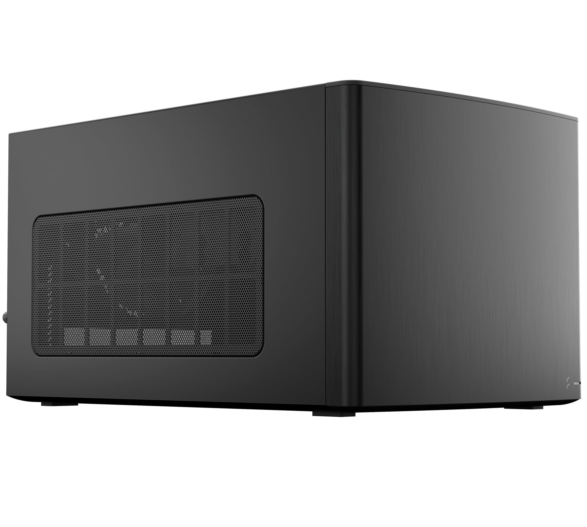
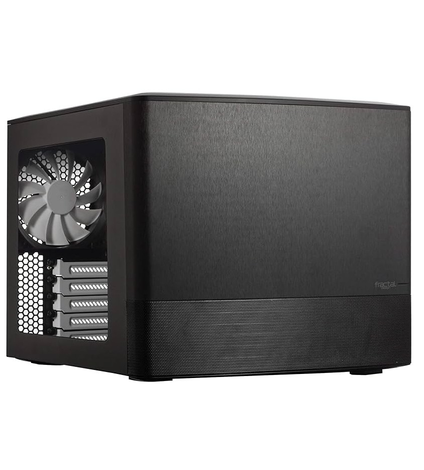
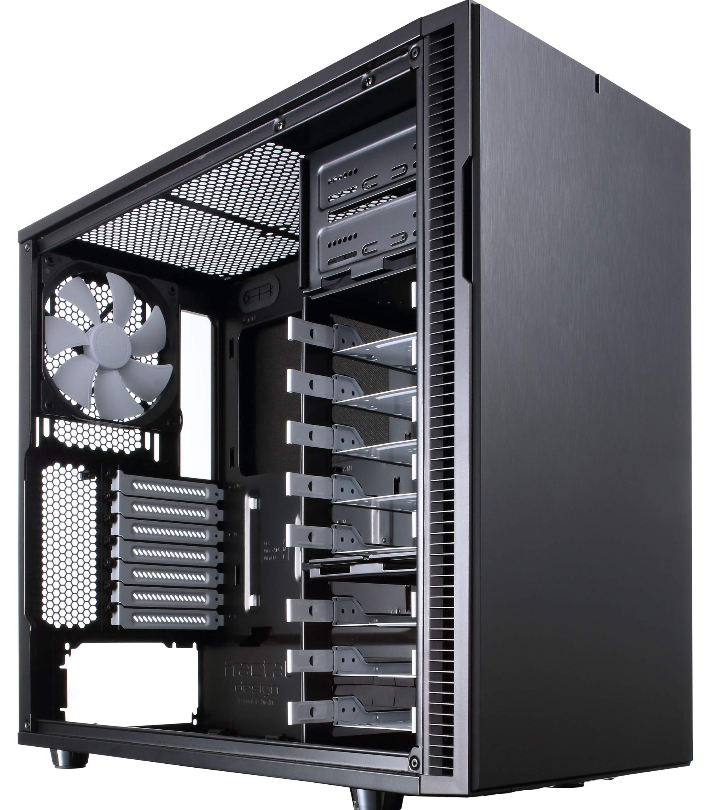
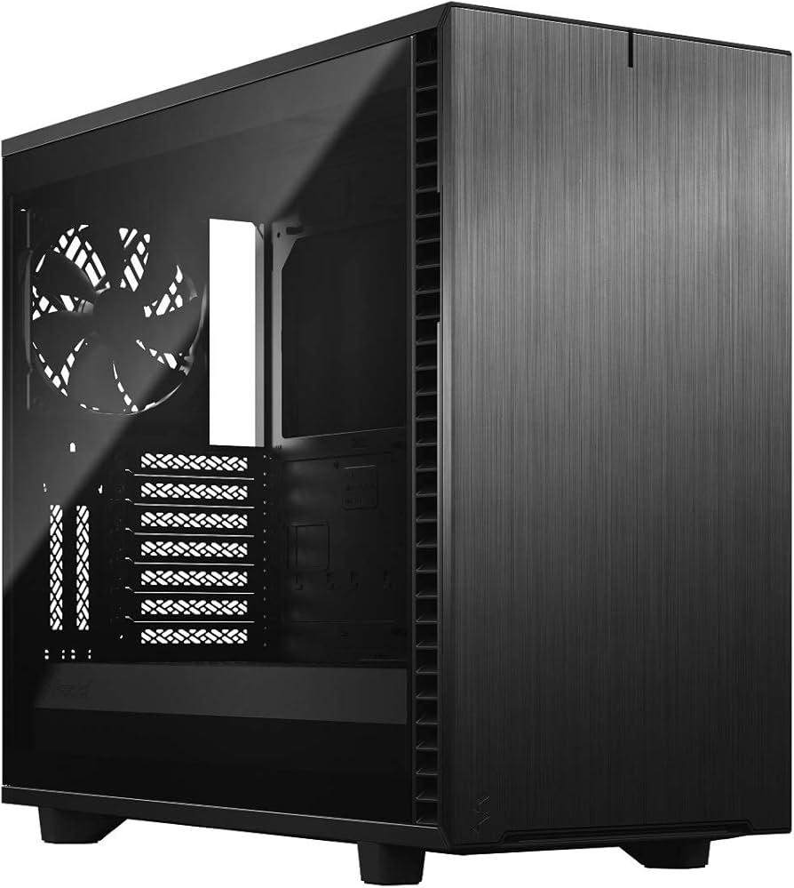
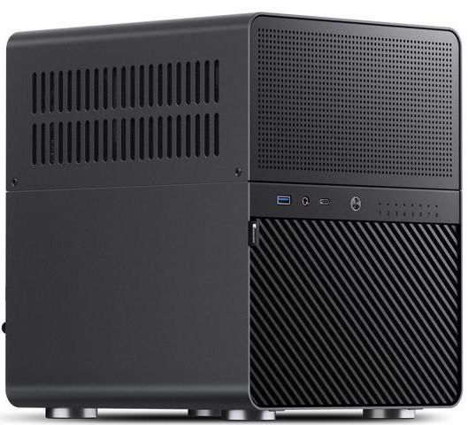
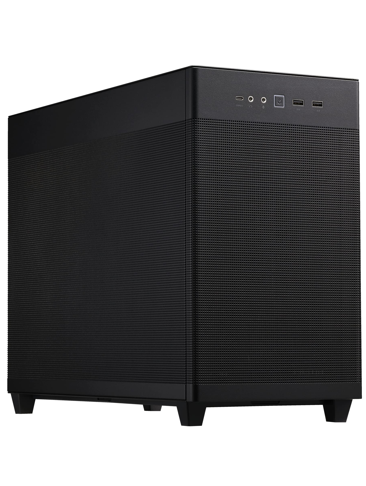
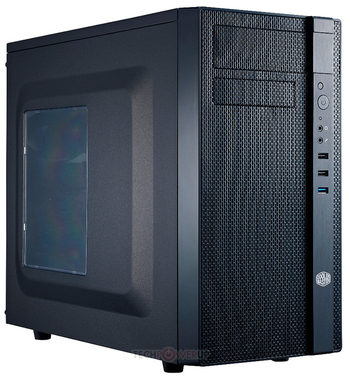

# Choosing Hardware?

If I was to build a server again, I'd only be only slightly less confused on how to go about it than I was the first time. Here are some of the stuff I remember.

### 💾 USB

The **Unraid OS runs off of a USB** instead of it being installed on one of your drives. The one requirement of the USB is **it needs to have a GUID**. This is how Unraid links your license to the USB.

Some popular USB options mentioned a lot in the Unraid Discord include Transcend Jetflash 780 (high quality stuff), Samsung Bar Plus, and the Cruzer Fit. Unraid recommends using a USB with **32GB or less**.

### 🚗 Hard Drives

There are a few things to consider when purchasing hard drives.

#### CMR vs SMR

CMR and SMR are different ways data cant be written to the drive, and **CMR is better**.  Some people say you can get away with using a SMR drive if you aren't using it as a parity drive, but it's your call.

#### Buying Used HDDs?

Server communities such as [serverbuilds.net](https://www.serverbuilds.net/) actually recommend you to buy used hard drives. And I know I know, you're probably saying "that sounds like the exact opposite of what I should do."

Reasons for using used hard drives:

1. Unlike SSDs, **hard drives don't have a set amount of data it can write until it dies** so they can run for a long time. A brand new HDD also has a chance of dying right away so it's kind of like a lottery. With the used drives they are at least tested before being sent out (if bought from a reputable place).
2. **Used drives are significantly cheaper** than new drives when you're looking at large storage sizes. Like, saving hundreds of dollars cheaper.

Reasons against using used hard drives:

1. These server grade drives are known to be **noisey**. How noisy you ask? The noise is only really a worry if the server is going to be in the same room where people frequent a lot (e.g. bedroom, living room). With one drive it's a baby hum, but the merrier the drives, the louder the hum. Unraid does have a feature where it turns off the drive if it's not in use, however a drive is at its nosiest when starting up.
2. Now these bad boys do get bumping and grinding with their **vibrations**. You might've read some worrisome posts online about hearing the vibrations through walls. Those people probably had a mATX server on something hollow and lightweight like a desk or cabinet. Some people put the server in a room that's not frequented often or that's already loud like the laundry room. The solution I found was to put a handful of thick neoprene foam sheets under the server. I'm unsure if this is necessary for a mid tower case on the ground.

#### HBA Controllers

These are PCIe cards that add extra SATA ports allowing you to connect more drives than your motherboard can support (they typically have 4 ports). Drives can also have SAS ports instead of SATA, so there are respective controllers for those as well.

### 🏎 SSD

People often put a SSD in their build as a cache drive. For two reasons:

1. So the system files can be on the SSD, making the server more responsive and reducing HDD noise.
2. Files will download faster. The files would then later get moved from the SSD to the array using Unraid's Mover feature. 

Even though Unraid's main features are towards hard drives, you can 100% have an all SSD Build.

When **installing the cache drive** that you're going to put the system files on, **put it in the first M.2 slot**. The first slot has more stable connection with the CPU. I made the mistake of putting it in the second M.2 slot thinking that both slots are the same speed so it shouldn't matter. It DOES matter. By having the drive in the second slot, my docker was crashing when things got hot. 

A **cache drive won’t give you faster transfers over the network** unless your **network hardware can keep up**. You'd have to upgrade your network hardware of your server and PC to take advantage of those 10 GbE speeds. Which include having a 10 GbE Network Interface Card on both your server and PC, and 10 GbE switch to connect the two (or you can bypass the switch and just have two connected by a cable.)

### 🧠 CPU

Assuming the server is for regular home lab uses and nothing out of the ordinary, you ideally want a low power CPU. Basically a entry or mid tier CPU, rather than something on the higher end. Seeing how some people use really old parts, the amount of cores and threads isn't a huge concern, get whatever you're able to afford.   

**Quick Sync** may be something to look out for when choosing a CPU. It allows for hardware transcoding (converting video and audio to other resolutions/formats) for media servers, rather than only relying on software transcoding which is super slow. Plex requires a premium pass for hardware transcoding while it's free on Jellyfin.

### 🔌 PSU

Same deal as buying a power supply for your PC. Don't be an asshole idiot and grab a cheap unit because you can't see the performance. You can refer to [this](https://docs.google.com/spreadsheets/d/1akCHL7Vhzk_EhrpIGkz8zTEvYfLDcaSpZRB6Xt6JWkc/edit?gid=1719706335#gid=1719706335).

### 🗄 Case

Ah yes cases, this is where things can be spicy. There are regular PC cases with a lot of HDD drives, server oriented cases, and some cases with sleds so you can easily swap on drives. Here are some options that I'm aware of:

==- List of Cases
|     |     |     |
| :---: | :---: | :--- |
Fractal Node 304|  | <ul><li>$110 USD</li> <li>Mini ITX case </li><li>Holds 6 drives</li><li>Very Compact</li><li>I have this and I personally wished I was able to get the bigger version as my drives be a lil toasty </li></ul>
Fractal Node 804 |  | <ul><li>$135 USD</li> <li>mATX case </li><li>Holds 10 drives</li><li>Bigger version of the ITX with better cooling</li>
Fractal Define R5 |  | <ul><li>$135ish USD</li> <li>Mid Tower Case </li><li>Holds 8 Drives</li><li>Fans directly blow on the drives, but the bottom 3 less so. But it's modular so you can supposedly move the drive cage up</li><li>Has sound deadening material</li>
Fractal Define R7 |  | <ul><li>$199 USD</li> <li>Mid Tower Case </li><li>Holds 6 drives out of the box but can hold up to 14 by by purchasing additional mounts</li><li>XL version comes with 8 out of the box and holds up to 18 </li><li>Has sound deadening material</li>
Jonsbo N Cases (N2 and beyond) |  | <ul><li>Extremely expensive, starting $200 USD, but discounted 30% on sale</li> <li>The N3 (holds 8 drives) seems to be the most popular </li><li>Objectively the best looking and features hot swappable bays</li><li>They aren't without their flaws. Some models don't have the best airflow. They also have a lot of passive cooling which means noise gets out more  </li>
Asus Prime AP201 |  | <ul><li>$90 USD</li><li>mATX case</li><li>Holds 3 Drives</li>
Cooler Master N400 |  | <ul><li>$76 USD</li> <li>Full Tower case</li><li>Holds 8 Drives </li>
===

### ❓ What If I want a cheap build to test this server stuff out?

The HP Elitedesk 800 G4 SFF is a great option. It can hold 2 drives and also has 2 M.2 slots. The i5-8500 that it sports also has 6 cores.

### 📦 Buying Used Parts

A lot of the people who know what they're doing get old and used parts for making these kinds of servers. In fact, there's a [whole community](https://forums.serverbuilds.net/) dedicated to this. However eBay is often used for buying these parts, which may not be available for everyone.

