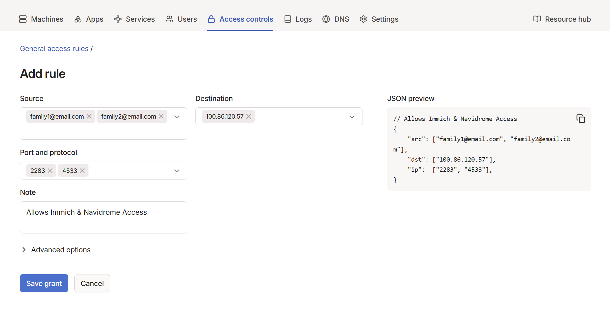

# Giving Access

<div style="color: black;">

Currently you can access all your services from the devices that are on your Tailscale network. If you were to give someone access to your network, that means they will also have access to all of your services and server files. Fortunately, there are multiple ways to allow someone access to specific containers. 

The two ways I'll show below are **TSD + Label Manager** and **Tailscale's ACL**. 

**TSD + Label Manager** is what the creator of Unraid's Tailscale plugin suggests to use instead of Unraid's built in implementation. The cool thing about this method is that each container get it's own lettered IP address. Which means you could access a container by typing `container.funnyword1-funnyword2.ts.net`, rather than remembering your Tailscale IP and the port of each container. **Tailscale's Access Control List** basically acts as a permission manager. 

### 🔀 TSD + Label  Manager

 Note, this method currently doesn't support TCP/UDP stuff which is necessary for giving access to game servers.

1. Install **TSD Proxy** and **Label Manager** by EDACerton.
2. Go to /mnt/user/appdata/TSDProxy and open tsdproxy.yaml and make these 3 changes
   ```
   targetHostname: host.docker.internal

   defaultProxyProvider: default

   tryDockerInternalNetwork: true
   ```
3. Go to **Settings** → **Users Utilities** → **Label Manager**.
4. **Find the container** you want (it has to be running) → click **Edit** → select **Yes**.
    - You can also turn on advanced view on the top left to change the name of how it'll appear on Tailscale.
5. Open the **Web UI for TSD Proxy**. It'll show "authenticating" for the container you just added. **Click on it** → click **connect** → click **Open in admin console** → and click **Approve**. 
    - If nothing shows up on TSD Proxy, try checking the container you're trying to add, it might have stopped. If the container didn't stop and it still doesn't show, restart TSD Proxy.
6. Now go to the **Admin Console** on Tailscale, and you'll see the container you just added as a device. Where you can share it to someone. You can also now access the container with its own lettered Tailscale IP. Upon the first load, it might take a few minutes (sometimes even 5), so give it some time to let it *compose* itself. 

#### ✨ Special Cases 

For some containers, including qBittorrent and SABnzbd, they require a few extra steps:

1. Go to **Label Manager** and click on the container.
2. Enable **advanced settings** by toggling the bar on the top left.
3. Set the **Container Port** to `8080`.
4. Set **TLS Validate** to `Yes`. 

### 🧾 Access Control Lists

This method of giving access is adding someone to your Tailscale network, and only letting them access to specific ports. 

1. In the admin console, click **Users** → click **Invite external users**. Have the person accept it, approve them, and all that jazz. 
2. Click **Access Controls**, and then instead of JSON editor, click on **Visual editor**.
3. Here you can create the rules. Let's create a rule to let our family access Immich.
4. Enter their **email addresses** in **source**.
5. Enter your **server's Tailscale IP** in **destination**.
6. Add the **port** of the container you want in **ports and protocol**. 
7. You could add another port if you want all of those users to access another app. You can also make a group for your family or look into tags. ACL rules can be very flexible, but this is enough to get you started. 



### 🐌 Slow Speeds?

If you're running another VPN (e.g. Proton, Mullvad, etc) alongside Tailscale, and try to access a container through Tailscale, the connection speed is reduced by a lot. This is because Tailscale is forced to use a relay server rather than direct access. This is fine for static sites, but for media servers or even for immich it can be slow. In my experience the Tailscale's ACL method experiences slightly less slowdown than TSD + Label Manager. 

One way to bypass this is to use the browser extension for your VPN rather than the desktop app. Then from there you can split tunnel the Tailscale addresses you want ignored to not hinder the speed. 

There is a collaboration with Tailscale and Mullvad that let's you avoid this. However you then forego the ability to split tunnel.

</div>
